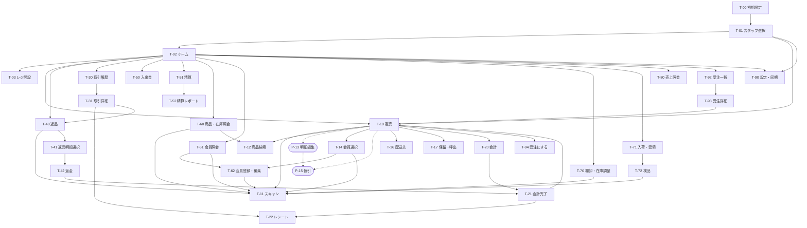

# 画面設計

端末 (MAUI のレジアプリ) とサーバ管理画面 (Blazor) の画面一覧。  
API は [api-design.md](api-design.md)、設計方針は [decisions.md](decisions.md)、プロジェクト構成は [architecture.md](architecture.md)。

- [1. 端末 (MAUI・スマートフォン)](#-1-端末-mauiスマートフォン)
- [2. サーバ管理画面 (Blazor)](#-2-サーバ管理画面-blazor)

---

## 📱 1. 端末 (MAUI・スマートフォン)

### 1.1 前提

シェル (上部のタイトルバー + F1〜F4) と販売・会計画面のデザインは [D-23](decisions.md#d-23-端末はメニュー型のホームと-f1f4-のシェルにする)。

| 項目 | 内容 |
| --- | --- |
| 端末 | 通常のスマートフォン (Android、縦持ち・片手操作)。画面幅は 360〜430 dp を想定 |
| 画面の骨格 | シェルは、上部のタイトルバー + コンテンツ + 下部の F1〜F4 のファンクションキー。各画面は `ContentView` で、`ShellProperty` でタイトルと F キーの文言・有効を宣言する |
| ハードウェアの戻る | `OnNotifyBackAsync` で処理する。根の画面 (T-00 / T-01 / T-02) では、アプリを終了せずにバックグラウンドへ回す (`AndroidHelper.MoveTaskToBack`) |
| シェルのデザイン | タイトルバーは紺 (`BlueDarken4`) にし、機能名を左寄せ、右に「店舗-端末 担当」と未送信バッジを出す。F キーはタイトルバーと同じ紺のバーに置き、役割で色を分ける ([D-23](decisions.md#d-23-端末はメニュー型のホームと-f1f4-のシェルにする)) |
| ホームのキー | 白の平らなキーを罫線で区切り、「販売」だけ青にする |
| ナビゲーション | Smart.Navigation の `ViewId` 列挙で遷移する (`Navigator.ForwardAsync(ViewId.Xxx)`)。パラメータは `NavigationParameter` で渡す |
| 遷移のアニメーション | 各画面に `[Hierarchy(n)]` を付け、階層が深くなる遷移は右から (Forward)、浅くなる遷移は左から (Back) スライドする ([D-23](decisions.md#d-23-端末はメニュー型のホームと-f1f4-のシェルにする)) |
| ダイアログ | MauiComponents の `IDialog` (確認 / 情報 / トースト / ローディング) と、`IPopupNavigator` のポップアップ (`DialogId`)。確認と情報は、`IDialog` を実装する `SheetDialog` が `Confirm` / `Message` のシートに変換し、OS のダイアログを出さない |
| シート | ポップアップは、画面の下端に寄せたシートにする (幅いっぱい、上角が丸い。CommunityToolkit の Popup なので重ねて開ける)。一覧からの選択 (操作メニュー・絞り込み・承認者) も、OS のダイアログではなく `Select` シートで行う ([D-24](decisions.md#d-24-端末の入力は電卓と下端のシートにする)) |
| 画面の組み方 | 灰色の背景に見出し (絵文字付き) を置き、その下に幅いっぱいの白い面を並べる (`SectionPanel`、`PosSectionTemplate`)。角丸の箱 (カード) は並べず、角丸はチップ・アバター・ボタン・下端のシートだけに使う ([D-25](decisions.md#d-25-画面は平らな面で状態を示す)) |
| 金額と集計 | 主な金額 (純売上・お釣り・合計) は、白いバーに大きく出す。件数や金額の集計は、罫線で区切った表にする |
| 一覧の行 | 状態のある一覧 (取引履歴・未送信・保留・棚卸・返品明細・入荷の伝票・検品・受注) は、左端のバーと行の背景で状態を示し、区切り線で並べる。タップできる行はリップルを出す |
| 行の中の表示 | 状態は色付きのチップ (`LabelChip`)、コードは等幅、会員はイニシャルのアバターで示す |
| アイコン | 背景で使い分ける。明るい背景は色付きの絵文字、塗りつぶしの上は白い単色のアイコンか白い文字にする ([D-25](decisions.md#d-25-画面は平らな面で状態を示す)) |
| アニメーション | 金額の数え上げ、合計の背景の光り、未送信バッジの拡縮、表示時の浮き上がりを使う |
| 空の状態 | 一覧やスキャン待ちで表示するものがないときは、中央に絵文字を出す (`PosEmptyStack`)。操作の案内文は添えない |
| アプリのアイコン・スプラッシュ | 紺 (`BlueDarken4`) の背景に白いレジのグリフ (`Resources/AppIcon`、`Resources/Splash`) |
| 数値入力 | OS のソフトキーボードに依存せず、数値と番号は電卓で入力する ([D-24](decisions.md#d-24-端末の入力は電卓と下端のシートにする)) |
| スキャン | `BarcodeScanning.Native.Maui` (`BarcodeController` + `CameraView`) で、1D (JAN/EAN) と 2D (QR) を連続で読み取る |
| スキャンの用途 | 商品 JAN、会員証 (QR / バーコード)、レシート QR (返品時の取引呼び出し)、設定 QR (初期設定の画面の中で読む) |
| 設定の保存先 | `IPreferences` (`Settings`) に、サーバ URL・店舗 ID・端末 ID・登録日時・「ログイン後にシフト開設済みなら販売画面を開く」を保存する。端末のトークンは `SecureStorage` に保存する |
| 設定の入力 | サーバ URL は、印刷した設定 QR (`Key=Value` 行、`SettingParser` 互換) で読む。ペアリングコードは電卓で入れ、店舗と端末はペアリングで決まる ([D-35](decisions.md#d-35-認証は管理画面のログイン端末のトークンスタッフの-pin-にする)) |
| 通信 | `HttpService` (HttpClient + System.Text.Json、[D-28](decisions.md#d-28-端末は-viewmodel-から-service-と-usecase-を呼ぶ)) + `NetworkService` (接続確認・インジケータ・エラー通知)。`XxxRequest` / `XxxResponse` は `Pos.Contract` を参照する |
| ローカル DB | Smart.Data.Accessor + SQLite。マスタと自店在庫のキャッシュ、取引・シフト・入出金、前受金のコピー、保留、Outbox を置く ([db-design.md §6](db-design.md#-6-端末ローカル-db-sqlite-の概要)) |
| レシート | 画面表示 + 電子レシート (レシート番号を `QRCoder` で QR にして表示)。レシート画像と精算レポートのテキストは共有できる |
| オフライン | 未送信件数を、タイトルバーにバッジで出す。返品の元取引は、オフラインなら端末の取引から探す |
| オンライン限定の機能 | 会員の検索・照会・登録、他店在庫、シリアル番号の検索、入荷・受領、受注、売上照会。通信できないときは、その旨を表示する |

#### ボタンの色

| 色 | F キー | ポップアップの下段のボタン |
| --- | --- | --- |
| 灰青 | F1 (戻る系) | キャンセル |
| 青 | F2・F3 (操作) | — |
| 橙 | F4 (主操作) | 確定 |
| 赤 | — | 削除 |
| 灰 | 無効のキー | — |

#### アイコン

| 場所 | 扱い |
| --- | --- |
| 明るい背景 (見出し・一覧・メニュー・メッセージ・ホームのキー・設定のボタン) | 色付きの絵文字。標準でテキスト表示になる文字 (ℹ️ ⚙️ ↩️ ▶️ ⏸️ など) には U+FE0F を付ける |
| トースト | 色付きの絵文字。OS が描き、背景の明るさが Android のバージョンとテーマで変わるため |
| 塗りつぶしのチップ、色付きのボタン (検索・番号入力・削除・ホームの販売) | 白い単色のアイコン (Material Icons) |
| シートの ✕ ✔、小さな丸ボタン (数量の増減、会員・明細の値引・希望日・支払を外す) | 白い文字 |
| カメラの画面のバー (濃い青) のメッセージ | 追加できたときは白い ✓、ほかのとき (見つからない、設定 QR でない、カメラの権限がない、登録できない) は白い ✕ で始める |
| アイコンだけの白いボタン (販売の操作)、展開のボタン | Material Icons のグリフ |
| 入出金の種別ボタン (選択で背景が濃くなる) | 選択中だけアイコンを白にする |

#### アニメーション

- 合計・お釣り・純売上は数え上げる
- 販売の合計は、変わったときに背景を光らせる
- 未送信バッジは、要確認があると拡縮を繰り返す
- 面と一覧は、表示時に下から浮き上がらせる (続けて更新する販売の明細と棚卸には付けない)

#### 空の状態

- 絵文字: 🛒 販売 / 🔍 商品 / 👤 会員 / ⏸️ 保留 / 📦 棚卸 / 📥 入荷 / 📋 受注 / 🧾 取引履歴 / ↩️ 返品
- 文言は、該当がない・取得できないときだけ添える
- オンラインで取得する画面 (会員照会、会員選択、入荷・受領、売上照会、受注一覧、受注詳細、取引履歴のシリアル番号の検索) は、取得中は結果を隠す。  
  取得できないとき (📡) は、結果の上に重ねる
- 詳細の一部をオンラインで取得するとき (会員照会の履歴、商品照会の他店在庫) は、見出しを残して「📡 取得できません」を出す

#### 数値入力

- 数量・金額・枚数・番号 (電話・郵便番号・コード・伝票番号・生年月日) は、すべて `InputNumber` ポップアップ (電卓、`NumberInputModel`) で入力する
- 入力欄は、タップで電卓を開くボタンにする
- 会計画面だけは、テンキーを画面に埋め込む
- 会員選択・商品検索の検索欄と、棚卸・検品のコード入力には、番号入力のボタン (Material Icons のダイヤルパッド) を置く
- 文字 (名前・住所・備考・検索キーワード) だけを `Entry` で入力する。  
  キーボードは欄をタップしたときだけ出す (遷移時の自動フォーカスはしない)

### 1.2 ナビゲーション構成

メニュー型 ([D-23](decisions.md#d-23-端末はメニュー型のホームと-f1f4-のシェルにする))。  
ホームに機能キーのグリッドを置き、各機能からは F1 (戻る / メニュー) でホームへ戻る。

- ホームのキーは「販売」を最上段に 2 列分の幅で置く
- 設定「ログイン後にシフト開設済みなら販売画面を開く」で販売画面を直接開ける

### 1.3 画面遷移



実線は `ViewId` による画面遷移、点線はポップアップ (`DialogId`)。  
次の遷移は図に描かない。

- 戻る遷移と、戻り先 (`WithReturnTo`) へ進む遷移
- T-20 → T-14、T-21 → T-02、T-40 → T-30、T-51 → T-90、T-90 → T-00 / T-01

`[Hierarchy(n)]` の n は、この図の深さにする (T-00 = 0、T-01 = 1、T-02 = 2、ホーム直下 = 3、その下 = 4 …)。  
遷移アニメーションは、遷移元と遷移先の n の差で決まる ([D-23](decisions.md#d-23-端末はメニュー型のホームと-f1f4-のシェルにする))。

- 親が複数ある画面は、最も深い親 + 1 にする
- T-21 → T-10 や T-93 → T-10 のように、浅い画面へ進む線は数えない

### 1.4 画面一覧

F1〜F4 はシェルの下部のファンクションキー。  
「—」は無効。

| ID | 画面 | 目的 | 主な要素・操作 | F1 | F2 | F3 | F4 | 使用 API |
| --- | --- | --- | --- | --- | --- | --- | --- | --- |
| T-00 | 初期設定 | 管理画面で発行したペアリングコードで端末を登録し、初回同期する | 上に `CameraView` と読み取り枠、その下にメッセージのバー (読めない・登録できないときだけ) とサーバ URL・ペアリングコードの欄。登録した店舗・端末名と、初回同期の進捗を表示する | — (再登録のときは戻る) | ライト | コード | 登録 | `POST /terminals/pair`, `GET /sync/masters`, `GET /inventory` |
| T-01 | スタッフ選択 | 担当者を決める | 所属店舗のスタッフ一覧 (`CollectionView`) をタップし、PIN を電卓 (伏せ字) で入力する。PIN 未設定のスタッフはチップ「PIN 未設定」を出し、選べなくする | 設定 | — | — | — | (ローカル) |
| T-02 | ホーム | 機能選択 | タイトルバーに店舗・端末・担当・未送信バッジ、上端にシフトの状態 (開設中 / 未開設のチップと営業日・開設時刻・担当)、機能のキー。F キーは出さない | | | | | (ローカル) |
| T-03 | レジ開設 | シフト開始 | 営業日、釣銭準備金 (`InputNumber`)、担当 | 戻る | — | — | 開設 | `GET /shifts/current`, `POST /shifts` (Outbox 経由) |
| T-10 | 販売 | 明細を組み立てる | 会員チップ (タップ → T-14、✕ で外す)、明細リスト (タップ → P-13、左スワイプで削除)、小計・値引・合計・内消費税、画面内のボタン [⋯] (操作のシート) | メニュー | スキャン | 検索 | 会計 | (ローカル計算) |
| T-11 | スキャン | カメラで読み取り | `CameraView` と、その下に読み取り結果のバー (読めない・見つからないときと、追加した商品)。モードは商品 (販売) / 商品 (照会・棚卸・検品) / 会員 / レシート | 戻る | ライト | 手入力 | 完了 | ローカル (`Products` キャッシュ) |
| T-12 | 商品検索 | スキャンできない商品を探す | キーワード (名称 / 型番 / コード)、部門ブラウズ (2 階層)、結果の一覧 (左に画像のサムネイル。ないときはアイコン)。結果をタップして追加する (T-60 から開いたときは選んで戻る) | 戻る | 部門 | クリア | — | ローカル (`Products` キャッシュ)、`GET /products/{id}/image` |
| P-13 | 明細編集 (ポップアップ) | 数量・値引など | 数量 −/+ と `InputNumber`、単価変更 (`AllowsPriceOverride` のみ)、明細値引 (定義済みの選択か、任意額・率 + 理由)、シリアル番号 (同じ番号は重ねられない)、備考、削除、OK / キャンセル | | | | | (ローカル計算) |
| T-14 | 会員選択 | 取引に会員を紐付ける (オンライン) | 検索 (会員番号・電話・名前)、結果一覧、選択後に残高を表示 | 戻る | スキャン | 新規 | 解除 | `GET /customers/lookup`, `GET /customers` |
| P-15 | 値引 (ポップアップ) | 取引全体または明細の値引 | 定義済み一覧 / 任意額・率 (`InputNumber`) + 理由 (`ReasonSelect`) | | | | | (ローカル計算) |
| T-16 | 配送先 | 配送情報入力 | 宛名・電話・郵便番号・住所・希望日・時間帯・備考 | 戻る | 会員住所 | クリア | 確定 | — |
| T-17 | 保留・呼出 | 会計途中の一時退避 | 保留一覧 (端末ローカルのみ)、選択して呼出 / 破棄 | 戻る | — | 破棄 | 呼出 | — |
| T-20 | 会計 | 支払を受ける | 合計、ポイント利用 (残高表示)、支払済 / 残り、支払方法のボタン、埋め込みのテンキー + 金額ショートカット、[ちょうど]、支払リスト (複数可) | 戻る | ポイント | 会員 | 確定 | `POST /transactions` (Outbox 経由)、受注の会計は `GET /orders/{id}` |
| T-21 | 会計完了 | 釣銭と結果を見せる | 釣銭 (返品は返金額) を大きく表示 (数え上げ)、販売は合計とお預り、ポイント (付与・利用、返品は取消・返還) と残高、レシート番号 | — | レシート | — | 次へ | — |
| T-22 | レシート | 印字内容の確認・発行 | レシートのプレビュー (等幅フォント)、電子レシート QR (レシート番号)、共有 (画像) | 戻る | 共有 | 印刷 | QR | — |
| T-30 | 取引履歴 | 当シフト / 日付の取引を探す | 一覧 (レシート番号・時刻・金額・種別・状態・送信状態)、期間 / 種別の絞り込み、シリアル番号の検索 (オンライン) | 戻る | 絞込 | — | 再送 | ローカル、`GET /transactions?serialNumber=` |
| T-31 | 取引詳細 | 内容確認と後処理 | 明細・支払・ポイント・配送。取消は、開設中の同一シフト内の返品のない取引だけ (理由は `ReasonSelect`) | 戻る | レシート | 取消 | 返品 | `POST /transactions/{id}/void` (Outbox 経由)、端末にない取引と販売の取消の前の確認 (オンライン) は `GET /transactions/{id}` |
| T-40 | 返品 | 元取引を呼び出す | レシート QR のスキャン / 番号入力 (自店の端末番号 + 連番を電卓で) / 履歴から選択 → 元取引を表示 | 戻る | スキャン | 番号入力 | 履歴 | `GET /transactions/lookup`, `GET /transactions/{id}`, ローカル |
| T-41 | 返品明細選択 | 返す商品と数量 | 元明細ごとの返品数量 (残数量まで、`InputNumber`)、返金額・戻るポイントの自動表示、理由 | 戻る | 全数 | — | 次へ | (ローカル計算) |
| T-42 | 返金 | 返金方法 | 返金合計・ポイント返還・返金額、返金方法の一覧 (元の支払方法に「元の支払」と示す)、確認して確定 | 戻る | — | — | 確定 | `POST /transactions` (`Type = Return`、Outbox 経由) |
| T-50 | 入出金 | 現金の出し入れ | 種別 (入金 / 出金 / ドロワ開) の選択、金額 (`InputNumber`)、理由 (`ReasonSelect`) | 戻る | — | — | 確定 | `POST /shifts/{id}/cash-events` (Outbox 経由) |
| T-51 | 精算 | シフト終了 | 営業日と開設時刻、販売・返品・取消の件数と金額、現金の内訳と予想現金、未送信の警告、実査金額 (`InputNumber` か金種別)、過不足 | 戻る | 金種入力 | 未送信 | 精算 | `POST /shifts/{id}/close` (Outbox 経由) |
| T-52 | 精算レポート | 精算結果 | 集計元 (サーバ / 端末)、現金 (予想・実査・過不足を含む)・取引 (販売・返品・取消)・支払方法別・税率別・部門別・ポイント | 戻る | 共有 | 印刷 | ホーム | `GET /shifts/{id}/summary` |
| T-60 | 商品・在庫照会 | 価格と在庫を答える | スキャン / 検索 → 画像 (あるときだけ上に出す)・価格・税・還元率・自店在庫、他店在庫 (オンライン、店舗別一覧) | 戻る | スキャン | 検索 | 他店在庫 | ローカル、`GET /products/{id}/image`、`GET /inventory/{productId}` |
| T-61 | 会員照会 | 会員情報を見る (オンライン) | スキャン / 検索 → 基本情報・残高・ポイント履歴・購入履歴 | 戻る | スキャン | 検索 | 編集 | `GET /customers/lookup`, `GET /customers`, `GET /customers/{id}/points/history`, `.../transactions` |
| T-62 | 会員登録・編集 | 店頭での入会・変更 (オンライン) | 会員番号 (スキャン可)、氏名・かな・電話・メール・郵便番号・住所・生年月日・備考 | 戻る | スキャン | クリア | 保存 | `POST /customers`, `PUT /customers/{id}` |
| T-70 | 棚卸・在庫調整 | 実数登録・調整 | スキャン → 現在庫表示 → 実数 (棚卸) か増減 + 理由 (調整) → リストに追加 → 送信 | 戻る | スキャン | モード | 送信 | `POST /inventory/changes` (Outbox 経由) |
| T-71 | 入荷・受領 | 自店に届いた伝票を選ぶ (オンライン) | 自店の入荷予定と、自店宛に出荷済みの移動の一覧。行をタップすると T-72 を開く | 戻る | — | — | 更新 | `GET /inventory/receipts?status=Draft`, `GET /inventory/transfers?status=Shipped` |
| T-72 | 検品 | 届いた数を確認して受領する (オンライン) | 伝票 (仕入先か出荷店・種類・番号・備考) と確認した明細の数、コード入力、明細 (届いた数と予定の数・差) | 戻る | スキャン | — | 受領 | `POST /inventory/receipts/{id}/receive`, `POST /inventory/transfers/{id}/receive` |
| T-80 | 売上照会 | 売上の状況を見る (オンライン) | 期間・範囲・集計軸を選ぶボタン (画面上部)、純売上、件数・値引・税・会員・ポイント、集計軸の内訳 | 戻る | 期間 | 範囲 | 更新 | `GET /reports/sales/summary` |
| T-92 | 受注一覧 | 自店の受注を探す (オンライン) | 受注番号 / 宛名 / 電話の検索、状態の絞り込み、受注の一覧 (状態・種別のチップ、宛名・金額・受注番号・商品・希望日) | 戻る | 絞込 | — | 更新 | `GET /orders` |
| T-93 | 受注詳細 | 入荷・前受金・キャンセル・会計 (オンライン) | お客様・金額・前受金・状態・種別・受注番号、お客様 (電話・希望日・備考)、明細、前受金 (受取・返金の記録と会計で充てる額)、経過 (受注・入荷・完了・キャンセル) | 戻る | 入荷 | 操作 | 会計へ | `GET /orders/{id}`, `POST /orders/{id}/arrive`, `.../cancel`, `.../deposit`, `.../deposit/refund` |
| T-94 | 受注にする | 販売のカートを受注にする (オンライン) | カートの要約と会員、種別 (取り寄せ / 取り置き)、宛名 (会員の名前が初期値)、電話 (電卓)、希望日、備考 | 戻る | — | — | 登録 | `POST /orders` |
| T-90 | 設定・同期 | 端末管理 | 端末情報 (店舗・端末・担当・サーバ URL・登録日時・バージョン)、最終同期時刻と未送信件数、未送信一覧 (F3 で開閉)、「ログイン後にシフト開設済みなら販売画面を開く」、スタッフ切替、登録の解除 | 戻る | 再登録 | 未送信 | 同期 | `GET /sync/masters`, `GET /inventory`、未送信の送信 |

ポップアップ (`DialogId`) の一覧:

| `DialogId` | 用途 |
| --- | --- |
| `InputNumber` | 電卓 |
| `LineEdit` | 明細編集 (P-13) |
| `Discount` | 値引 (P-15) |
| `ReasonSelect` | 理由 (在庫調整・返品・取消・受注のキャンセル、入出金と値引) |
| `Select` | 一覧からの選択 (操作メニュー・絞り込み・時間帯・増減・承認者・受注の種別・前受金の支払方法・未送信の操作) |
| `Denominations` | 金種別入力 |
| `Message` | 情報 |
| `Confirm` | 確認 |

#### 共通

- 画面遷移は `ForwardAsync` だけを使う
- 戻り先を受け取る画面 (T-03 / T-11 / T-12 / T-14 / T-22 / T-62 / T-90) は、`Parameters.WithReturnTo` で受け取る (T-03 では開設後に進む画面)
- タイトルと F キーの文言・有効状態は、`shell:ShellProperty.*="{Binding ...}"` で動的に変えられる
- ポップアップの中から開くのは、次のものだけにする
  - 電卓 (`InputNumber`)
  - 理由 (`ReasonSelect`)
  - 一覧からの選択 (`Select`、`IPopupNavigator.ChooseAsync`)
  - 確認と情報のシート
  - P-13 からの値引 (P-15)
- 数量・単価・値引の値・金種の枚数は、電卓で入力する
- どの画面でもリクエストが 401 になったら、登録が解除されたと知らせて T-00 へ戻る。  
  トークンは破棄し、未送信は残す (再登録すると送る)

#### T-00 初期設定

- 設定 QR (`ApiEndPoint`) を読むと、サーバ URL を入れて電卓を開く。  
  コードを入れると、登録して初回同期する
- QR がないときは、サーバ URL とコード (電卓) を入力して F4 で登録する
- カメラの権限がなければ、バーで知らせて入力で登録する
- 読むのは QR だけにする。  
  設定 QR でない QR は知らせるだけで、欄を変えない
- 同じ QR は再読み取りしない (枠に残った QR で電卓を開き直さないように)。  
  リトライは F3 と F4 で行う
- 登録は、成功してから接続先とトークンを切り替える。  
  失敗しても今の登録のまま使える
- 初回と登録の解除の後は根の画面になり、戻るでアプリをバックグラウンドへ回す
- 登録済みの端末で開いたとき (T-90 の F2 からの再登録)
  - 登録の前に、今の登録が使えなくなることと未送信の件数を確認する
  - 未送信は、店舗コード・端末番号が同じ端末なら、その端末のものとして送る
  - F1 と戻るで T-90 に帰る (T-90 の戻り先を引き継ぐ)

#### T-01 スタッフ選択

- 開くと担当を外す (スタッフ切替や再登録の後に、前の担当を残さない)
- PIN は同期したハッシュで照合するので、オフラインでもログインできる
- PIN を 3 回間違えると、担当の選択に戻る
- F1 (設定) は T-90 を開き、戻ると T-01 に帰る

#### T-02 ホーム

- キー: 販売 (2 列幅) / 返品 / 取引履歴 / レジ開設 / 入出金 / 商品・在庫 / 会員 / 棚卸・調整 / 入荷・受領 / 受注 / 売上照会 / 設定・同期 (2 列幅)
- 「レジ開設」のキーは、開設中は「精算」になり T-51 を開く
- シフト未開設で販売 / 返品 / 入出金を選ぶと、開設へ誘導する。  
  開設後は元の画面へ進む

#### T-03 レジ開設

- サーバに開設中のシフトが残っていれば (再インストール時など)、引き継ぐ

#### T-10 販売

- 受注から会計しているときは、会員の下に受注番号のバーを出す (前受金があれば金額も)
- [⋯] は `Select` シートで、次の操作を出す
  - 取引値引 (P-15)
  - 取引値引を解除 (取引値引があるとき)
  - 配送先 (T-16)
  - 保留する (その場で保留してカートを空にする)
  - 保留を呼び出す (T-17)
  - 受注にする (T-94。受注から会計しているカートでは出さない)
  - クリア
- シリアル番号が未入力の明細があると、会計に進まない。  
  案内のあとに、その明細の P-13 を開く

#### T-11 スキャン

- 販売のモードは連続読み取りにする。  
  読むたびに明細を追加し、バーに商品名・数量・合計を出す (同じ商品は数量を +1 する)
- 販売以外のモードは、1 件読んだら呼び出し元へ戻る。  
  会員・レシートは、読んだ値を呼び出し元に渡す
- 同一コードは 2 秒間抑制する
- 検出のフラッシュは省き、バイブレーションで知らせる
- 手入力は電卓 (`InputNumber`) で行う

#### T-12 商品検索

- 画像は、結果を出した後に上から順に入れる
- 取得した画像は端末に保存し、オフラインのときはそれだけを出す

#### P-13 明細編集

- 数量・単価は、電卓 (`InputNumber`) で入力する
- 明細値引は、取引値引と同じ P-15 で入力する (定義済み / 任意額 / 任意率 + 理由)
- 承認が必要な値引は、店長 / 管理者を承認者に選び、その PIN を入れる

#### T-20 会計

- 支払方法のボタンの文言は、支払方法の `shortName` (なければ `name`) にする。  
  ポイントと前受金のボタンは出さない
- 金額ショートカットは預り金に加算し、[ちょうど] は残りの全額にする
- 支払が済むと、「残り」の行がお釣りになる
- 受注の前受金は、支払リストの先頭に置いて外せなくする (✕ を出さない)
- 画面に入るたびに、前受金の全額を先頭の支払に置き直す。  
  オンラインなら、その前に受注を再取得する (返金や他の端末の会計に追従する)
- 次のときは、案内して T-10 に戻る
  - 受注が引き渡し待ちでなくなった (キャンセル・他の端末で会計済み)
  - 前受金が合計を超える
  - 前受金の支払方法が端末にない

#### T-21 会計完了

- 返品では表題が「返品完了」になり、[次へ] でホームへ戻る (販売は T-10 の次の会計へ進む)

#### T-22 レシート

- 受注から会計した取引は、受注番号を印字する
- プレビューは、`ReceiptTextBuilder` の 32 桁のテキストを SkiaSharp で桁位置に描画した画像にする (端末のフォントが等幅でなくても崩れない)
- 共有は PNG にする (共有するときに作る)
- 描画と QR の生成はバックグラウンドのスレッド (`Task.Run`) で行い、終わるまで IDialog のインジケータを出す
- 画像は Glide を通さずに SkiaSharp の画像のまま出し、インジケータを閉じたときには表示されているようにする
- シリアル番号で探した他の店舗・端末の取引は、その店舗と端末で組み立てる
- [印刷] は、押すと「印刷は未実装です」と知らせる (Bluetooth ラインプリンタでの印刷は [backlog.md](backlog.md#-後回しにしているもの))

#### T-30 取引履歴

- 絞り込みは画面上部のボタンで選ぶ (期間: 本シフト / 本日 / 昨日 / すべて、種別)。  
  その下に、件数の内訳をチップで出す
- 行は種別・送信状態・会員のチップと、時刻・担当・支払を示す。  
  右端で明細と支払を展開する
- 送信状態は Outbox から求める (送信済 / 未送信 / 要確認)
- 最上段の検索欄でシリアル番号 (完全一致) を探すと、一覧をサーバの全店の取引に置き換える (件数は「シリアル n 件」。取得できなければ「📡 取得できません」)
- 空で検索するか期間・種別を選び直すと、端末の履歴に戻る

#### T-31 取引詳細

- 明細にシリアル番号 (S/N) を表示し、受注から会計した取引は受注番号の欄を出す
- 端末にない取引 (シリアル番号で探した他の端末の取引) は、オンラインのときにサーバから開く
- レジ係の取消は、確認のあとに店長 / 管理者を承認者に選び、その PIN を入れる (`approvedByStaffId`)
- 営業日が締め済みの取消はサーバが拒否し (`DAY_CLOSED`)、未送信の要確認に出る。  
  端末は締めの状態を持たないので、事前には知らせない
- 返品のある販売は、取消を押せなくする。  
  返品は、端末で記録した返品とサーバから取得した返品済みの数量で判断する
- オンラインなら、販売の取消の前にサーバの最新の状態で他の端末の返品を確認して知らせる。  
  その販売の返品に未送信があるときは確認しない
- 確認せずに取り消した販売に他の端末の返品があれば、サーバが拒否する (`HAS_RETURNS`)。  
  拒否された取消は、未送信の要確認に出る

#### T-42 返金

- ポイント返還は自動にする (利用ポイント分)
- 残りは、返金方法を 1 つ選ぶ
- 返金方法は元の支払方法を先頭に並べ、前受金は出さない

#### T-51 精算 / T-52 精算レポート

- 現金の内訳は、釣銭準備金・現金売上・現金返品・入金・出金・前受金の受取と返金
- 前受金の行は、現金の前受金があるシフトだけ出す
- 予想現金は、ローカルの取引・入出金・前受金から計算する (`ShiftSummaryCalculator`)。  
  前受金は、サーバが受け付けた記録を端末にコピーしたもの
- 未送信が残っていれば、警告を出す。  
  [未送信] (未送信があるとき) は T-90 を開く
- 精算レポートは、未送信がなくオンラインならサーバの集計、それ以外は端末の集計にする。  
  どちらの集計かを画面に示す
- [印刷] は T-22 と同じく、未実装と知らせる

#### T-62 会員登録・編集

- 保存すると呼び出し元へ戻る。  
  販売から開いたときは、カートに紐付ける
- 削除された会員の更新は、知らせて会員を出さずに T-61 へ戻る
- スキャン (T-11) へ行く間の入力内容は、`CustomerDraft` (Scope) に残す

#### T-70 棚卸・在庫調整

- 棚卸 / 調整のモードと入力リストは `StockContext` (Scope) に置き、スキャン画面との往復で失わない
- コードは電卓かスキャンで入力する

#### T-71 入荷・受領 / T-72 検品

- オンライン限定 ([D-16](decisions.md#d-16-入荷と店舗間移動は伝票で持つ))
- T-71 の行は、左端のバーと種類のチップ (入荷 / 移動)、仕入先か出荷店、入荷予定日か出荷日時、納品書番号 (なければ発注番号) か移動番号、商品を示す
- T-72 の明細は、左端のバーと行の背景で状態 (未確認 / 一致 / 不足 / 過剰) を示す
- T-72 では、スキャンか JAN / 商品コードで明細を選ぶか、行をタップして届いた数を電卓で入れる
- 検品中の伝票と数えた数は `ReceivingContext` (Scope) に置き、スキャン画面との往復で失わない
- 伝票にない商品は受け付けない
- 数えていない明細は、予定 (移動は出荷) の数で受け取る。  
  受領の確認で、その件数を知らせる
- 受領したら、在庫の差分同期をすぐ行う

#### T-80 売上照会

- 画面上部のボタンで、期間・範囲・集計軸を選ぶ
  - 期間: 本日 / 昨日 / 今週 / 今月
  - 範囲: 自端末 / 自店 / 全店
  - 集計軸: 支払方法別 / 時間帯別 / 担当別 / 部門別 / 日別
- 自端末は、端末別集計から自分の行を出す (集計軸は選べない)
- 合計は、日別集計の Total を使う
- 純売上は白いバーに、件数・値引・税・会員・ポイントは罫線の表に出す
- 集計軸の内訳は、純売上に対する割合のバーで示す

#### T-92 受注一覧 / T-93 受注詳細

- オンライン限定
- 取得中は結果を隠し、取得できないときは結果の上に案内を重ねる
- T-93 は、取得できなければ「📡 取得できません」だけを出す。  
  操作のキーも押せなくする
- ない受注は、知らせて T-92 へ戻る
- T-92 の状態の絞り込み: 未完了 / 入荷待ち / 引き渡し待ち / 完了 / キャンセル / すべて
- T-92 の行は、左端のバーと背景で状態を示す
- [入荷] (入荷待ちのとき) は、確認して引き渡し待ちにする
- [会計へ] (引き渡し待ちのとき) は、明細・会員・前受金をカートに入れて T-10 へ進む
  - レジ未開設なら案内する
  - 販売中の明細があれば、置き換えるか確認する
  - 単価は、売価を変更できる商品だけ受注の単価にする
- [操作] (未完了のとき) は `Select` シートで、次の操作を出す
  - 「前受金を受け取る」(前受金がないとき) か「前受金を返す」(あるとき)
  - 「受注をキャンセル」
- 前受金の受取は、支払方法 (現金・カード・QR・電子マネー) → 金額 (電卓。受注の金額まで) → 伝票番号 (要る支払方法だけ) → 確認の順に進む
- 前受金の返金は、全額を受け取った方法で返す
- 前受金の受取と返金には、レジの開設が要る
- キャンセルの理由は `ReasonSelect` で選ぶ。  
  前受金があれば、返してからキャンセルする

#### T-94 受注にする

- 登録するとカートを空にして T-10 に戻り、受注番号を知らせる
- 会員がいなければ宛名が必要

#### T-90 設定・同期

- 未送信一覧は F3 で開閉する。  
  要確認の未送信は、再送・破棄・詳細を選べる
- スタッフ切替は T-01 を開く
- 登録の解除はトークンを破棄して T-00 を開く (ローカル DB と未送信は残す)
- F2 (再登録) は T-00 を開く。  
  T-00 のカメラで設定 QR を読むか、入力して再登録する (登録せずに F1 で T-90 に帰れる)

### 1.5 主要画面のレイアウト

シェル (上部タイトル、下部 F1〜F4) の上に描く。

#### T-10 販売

```
┌──────────────────────────────┐
│ 販売          S001-02 山田 ⚠2 │  タイトルバー: 端末 / 担当 / 未送信バッジ
├──────────────────────────────┤
│ 👤 佐藤 花子   8,074 pt      ✕ │  会員チップ (未設定なら「会員を選択」)
├──────────────────────────────┤
│ デジタルカメラ X-100           │  タップ → P-13 明細編集
│   ¥80,000 × 1  -¥4,000  ¥76,000│  左スワイプ → 削除
│ SD カード 64GB                 │
│   ¥2,000 × 2             ¥4,000│
│ 配送料                         │
│   ¥1,100 × 1             ¥1,100│
│                                │
├──────────────────────────────┤
│ 小計 ¥85,100   値引 -¥5,000 [⋯]│  ⋯ = 操作のシート (T-10 の補足)
│ 合計 ¥80,100    内消費税 ¥7,281 │
├──────────────────────────────┤
│ [メニュー][スキャン][ 検索 ][ 会計 ]│  F1〜F4
└──────────────────────────────┘
```

- 会員は会計画面 (F3) からも紐付けられる (ポイント利用のため)

#### T-20 会計

```
┌──────────────────────────────┐
│ 会計                           │
├──────────────────────────────┤
│ 合計                 ¥80,100   │
│ ポイント利用 [ 5,000 ] / 8,074 │  F2 ポイント → 利用ポイントを電卓で (初期値は使える上限)
│ 支払済               ¥55,000   │
│ 残り                 ¥25,100   │  払い終えると「お釣り」の行になる
├──────────────────────────────┤
│ ✅ ポイント     ¥5,000       ✕ │  支払リスト (複数可)
│ ✅ クレジット  ¥50,000 1234-… ✕ │
├──────────────────────────────┤
│ [現金] [クレジット] [QR] [電子マネー] [商品券] ›│  横スクロール
│ 預り金               ¥30,000   │
│ [ 7 ][ 8 ][ 9 ]  [ ¥10,000 ]   │  埋め込みテンキー (NumberInputModel)
│ [ 4 ][ 5 ][ 6 ]  [ ¥5,000 ]    │
│ [ 1 ][ 2 ][ 3 ]  [ ¥1,000 ]    │
│ [ 0 ][ 00 ][ ⌫ ] [ ちょうど ]  │
├──────────────────────────────┤
│ [ 戻る ][ポイント][ 会員 ][ 確定 ]│  F1〜F4
└──────────────────────────────┘
```

- 現金以外は、「残り」の全額を既定値にする
- `RequiresReference` の支払方法は、伝票番号の入力を求める
- 確定すると取引を Outbox に保存し、すぐに T-21 へ進む (送信の完了を待たない)

#### T-11 スキャン

```
┌──────────────────────────────┐
│ スキャン (商品)                 │
├──────────────────────────────┤
│                                │
│      ┌────────────────┐        │
│      │  CameraView     │        │  枠内で連続読み取り、検出時に振動
│      └────────────────┘        │
│  ✓ SD カード 64GB を追加 (×2)  │  読み取り結果のバー (商品名・数量・合計)
├──────────────────────────────┤
│ [ 戻る ][ライト][手入力][ 完了 ]│  F1〜F4
└──────────────────────────────┘
```

#### T-02 ホーム

```
┌──────────────────────────────┐
│ ホーム        S001-02 山田 ⚠2 │
├──────────────────────────────┤
│ [開設中] 営業日 … 09:00 開設 担当 山田 │  シフトの状態 (未開設なら「未開設」と担当だけ)
│ [          販売            ]  │  2 列幅
│ [   返品    ][  取引履歴   ]  │
│ [  レジ開設  ][  入出金   ]  │  開設中は「精算」
│ [ 商品・在庫 ][   会員    ]  │
│ [ 棚卸・調整 ][ 入荷・受領 ]  │
│ [    受注     ][ 売上照会  ]  │
│ [        設定・同期         ]  │  2 列幅
│                                │
│          Version 1.0           │  フッタ
└──────────────────────────────┘
```

---

## 💻 2. サーバ管理画面 (Blazor)

### 2.1 前提

構成の判断は [D-22](decisions.md#d-22-管理画面はサーバに同居させservice-を呼ぶ)。

| 項目 | 内容 |
| --- | --- |
| 構成 | `MudLayout`: `MudAppBar` + `MudDrawer` (左ナビ、折りたたみ可) + `MudMainContent`。一覧ページ + 詳細 / 編集は `IDialogService` のダイアログ |
| ホスティング | Blazor Web App (Interactive Server)。API と同じ ASP.NET Core に同居する (ポート 8080) |
| UI ライブラリ | MudBlazor |
| ナビ | `MudNavMenu` + `MudNavGroup` でグループ化し、項目は Material Icons。展開状態は `NavMenu` が持ち、今の URL を含むグループを開く |
| データアクセス | ページは `Services/` の Service を `[Inject]` して呼び、HTTP API は経由しない。Accessor はページから使わない ([D-27](decisions.md#d-27-サーバは-service-に手順を集めsql-は-accessor-に置く)) |
| 認証 | ログイン (Cookie)。役割は管理者 / オペレーターで、オペレーターにはマスタ・会社設定・ユーザー・端末登録・PIN・締めの解除の操作を出さない ([D-35](decisions.md#d-35-認証は管理画面のログイン端末のトークンスタッフの-pin-にする), [D-36](decisions.md#d-36-認可は要件で分け端末は自店自端末に限る)) |
| 帳票 | CSV は CsvHelper (`PushStreamHttpResult`)、PDF は OysterReport ([D-21](decisions.md#d-21-帳票はサーバが-pdf-にする)) |

#### UI ライブラリ

| 用途 | 部品 |
| --- | --- |
| 件数の多い一覧 (取引・受注・シフト・日次締め・現在庫・在庫変動・入荷・移動・発注・商品・顧客) | `MudDataGrid`。`ServerData` でサーバ側のページング・ソートを行い、Accessor の件数 + ページの取得結果をそのまま渡す |
| マスタ (店舗・端末・スタッフ・税率・値引・支払方法・調整理由・仕入先・ユーザー) と集計表 | 全件の `MudTable` |
| フォーム | `MudForm` + FluentValidation (`Models/Forms/{Xxx}Form` + `{Xxx}FormValidator`) |
| 通知 | `ISnackbar` |
| 確認 | `DialogService.ShowConfirm` |

### 2.2 ナビゲーション構成

```
📊 ダッシュボード                S-01   /
📈 売上
   ├ 売上集計                    S-10   /reports/sales
   └ 商品別売上                  S-11   /reports/products
🧾 取引
   ├ 取引                        S-20   /transactions
   └ 受注                        S-91   /orders
💰 精算
   ├ シフト                      S-30   /shifts
   └ 日次締め                    S-90   /daily-closings
📦 在庫
   ├ 現在庫                      S-40   /inventory
   ├ 在庫変動履歴                S-42   /inventory/changes
   ├ 発注                        S-48   /inventory/purchase-orders
   ├ 入荷                        S-45   /inventory/receipts
   ├ 店舗間移動                  S-46   /inventory/transfers
   ├ 調整理由                    S-44   /inventory/reasons
   └ 仕入先                      S-47   /inventory/suppliers
🏷️ 商品
   ├ 商品                        S-50   /products
   ├ 部門                        S-53   /categories
   ├ 税率                        S-54   /tax-rates
   ├ 値引                        S-55   /discounts
   └ 支払方法                    S-56   /payment-methods
👥 顧客                          S-60   /customers
🏬 店舗
   ├ 店舗                        S-70   /stores
   ├ レジ端末                    S-71   /terminals
   └ スタッフ                    S-72   /staff
⚙️ 設定
   ├ 会社設定                    S-80   /settings
   └ ユーザー                    S-92   /accounts   (管理者だけ)
```

### 2.3 画面一覧

| ID | 画面 | 種別 | 主な要素・操作 | 対応 API |
| --- | --- | --- | --- | --- |
| S-00 | レイアウト | シェル | `MainLayout`: `MudAppBar` (アプリ名、ログイン中の ID と [ログアウト])、`MudDrawer` + `NavMenu`、`ErrorBoundary`、`ReconnectModal` | `POST /auth/logout` (フォーム) |
| S-02 | ログイン | ページ (静的 SSR) | ID・パスワード。失敗と試行回数の上限 (1 分 10 回) は画面に戻して知らせ、ログイン後は元の画面へ戻る | `POST /auth/login` (フォーム) |
| S-01 | ダッシュボード | ダッシュボード | KPI カード、店舗別売上表、開設中シフト一覧、前日までの未締めの営業日、引き渡し待ちの受注、端末の通信状態、未受領の移動、警告、[更新] | `GET /reports/sales/summary`, `GET /shifts?status=Open`, `GET /daily-closings?status=Open&to=`, `GET /orders?status=Arrived`, `GET /terminals`, `GET /inventory/transfers?open=true`, `GET /inventory?negativeOnly` |
| S-10 | 売上集計 | 一覧 + グラフ | フィルタ (期間・店舗・集計単位)、合計のタイル (純売上・販売 / 返品件数・値引・ポイント)、純売上の棒グラフ (`MudChart`)、集計表 (合計行つき)、[CSV]、[売上日報を開く] | `GET /reports/sales/summary`, `.../summary/csv`, `GET /reports/sales/daily/pdf` |
| S-11 | 商品別売上 | 一覧 | フィルタ (期間・店舗・部門・並び順)、ランキング表 (販売・返品・純数量、純売上、値引、粗利)、[CSV]。並び順は純売上順 / 数量順 | `GET /reports/sales/products`, `.../products/csv` |
| S-20 | 取引一覧 | 一覧 | フィルタ (営業日・店舗・端末・種別・状態・レシート番号・シリアル番号)、`MudDataGrid` (日時・レシート番号・店舗 / 端末・担当・種別・状態・合計・ポイント・会員)、行クリックで S-21 | `GET /transactions`, `GET /transactions/lookup` |
| S-21 | 取引詳細 | ダイアログ | ヘッダ情報 (受注から会計した取引は受注番号と S-91 へのリンク)、明細 (シリアル含む)、値引、税率別集計、支払、ポイント、配送先、関連取引 (元取引 / 返品取引 / 取消情報) へのリンク、[レシート PDF] (控え・再発行)。参照のみで、取消・返品は端末で行う | `GET /transactions/{id}`, `GET /transactions/{id}/receipt/pdf` |
| S-91 | 受注 | 一覧 + ダイアログ | フィルタ、`MudDataGrid`、[追加] で登録のダイアログ、行クリックで詳細のダイアログ | `GET/POST /orders`, `GET/PUT /orders/{id}`, `.../arrive`, `.../cancel`, `.../pdf` |
| S-30 | シフト一覧 | 一覧 | フィルタ (営業日・店舗・端末・状態)、`MudDataGrid` (営業日・店舗 / 端末・担当・状態・開設・精算・売上・予想現金・実査・過不足)、行クリックで S-31。過不足は `StatusChip` で強調する | `GET /shifts` |
| S-31 | シフト詳細 | ダイアログ | 精算レポート (現金・件数と売上・ポイント・支払方法別・税率別・部門別)、入出金一覧、金種別枚数、取引一覧へのリンク、[精算レポート PDF]。現金は前受金の受取・返金を含む | `GET /shifts/{id}`, `.../summary`, `.../summary/pdf`, `.../cash-events` |
| S-90 | 日次締め | 一覧 + ダイアログ | フィルタ、`MudDataGrid`、行クリックで内容のダイアログ、[売上日報 PDF]、[締める] / [締めを解除] | `GET /daily-closings`, `.../preview`, `POST /daily-closings`, `DELETE /daily-closings/{id}`, `GET /reports/sales/daily/pdf` |
| S-40 | 現在庫 | 一覧 | フィルタ (店舗・部門・キーワード・「マイナスのみ」)、`MudDataGrid` (商品・店舗・数量・更新日時)、行クリックで S-41、[棚卸・調整] で S-43 | `GET /inventory` |
| S-41 | 商品別全店在庫 | ダイアログ | 店舗ごとの数量、変動履歴へのリンク | `GET /inventory/{productId}` |
| S-42 | 在庫変動履歴 | 一覧 | フィルタ (店舗・商品・種別・期間)、表 (日時・店舗・商品・種別のチップ・増減・処理後・理由・参照・担当) | `GET /inventory/changes` |
| S-43 | 棚卸・調整登録 | ダイアログ | 店舗、商品検索 (`MudAutocomplete`)、種別 (棚卸 / 調整)、数量、理由、担当、備考 | `POST /inventory/changes` |
| S-44 | 調整理由 | 一覧 + 編集ダイアログ | コード・名称・並び順・有効 | `/inventory/adjustment-reasons` |
| S-45 | 入荷 | 一覧 + ダイアログ | フィルタ、`MudDataGrid`、[入荷予定を登録] で登録のダイアログ、行クリックで詳細のダイアログ | `GET/POST /inventory/receipts`, `.../receive`, `.../cancel` |
| S-46 | 店舗間移動 | 一覧 + ダイアログ | フィルタ、`MudDataGrid`、[移動を依頼] で依頼のダイアログ、行クリックで詳細のダイアログ | `GET/POST /inventory/transfers`, `.../ship`, `.../receive`, `.../cancel` |
| S-47 | 仕入先 | 一覧 + 編集ダイアログ | コード・名称・電話・メール・備考・有効 | `/inventory/suppliers` |
| S-48 | 発注 | 一覧 + ダイアログ | フィルタ、`MudDataGrid`、[発注を作成] で登録のダイアログ、行クリックで詳細のダイアログ | `GET/POST /inventory/purchase-orders`, `GET/PUT .../{id}`, `.../order`, `.../cancel`, `.../pdf` |
| S-50 | 商品一覧 | 一覧 | フィルタ (部門・キーワード・販売状態・削除済み表示)、`MudDataGrid` (画像のサムネイル・コード・JAN・名称・部門・種別・価格・税率・還元率・属性・状態)、[追加] / 行の編集アイコンで S-51、行の削除アイコン、[CSV 出力]、[CSV 取込] で S-52。価格は外税のときだけ注記し、操作の列は右端に固定する | `GET /products`, `GET /products/csv`, `DELETE /products/{id}` |
| S-51 | 商品編集 | ダイアログ | 画像 (プレビュー、[画像を選択] [画像を削除])、`ProductForm`、[保存] | `POST/PUT /products`, `PUT/DELETE /products/{id}/image` |
| S-52 | 商品 CSV 取込 | ダイアログ | [ファイルを選択] でプレビュー、[取込] | `POST /products/import?dryRun` |
| S-53 | 部門 | ツリー + 編集ダイアログ | `MudTreeView` (2 階層)、並び順、[追加] [編集] [削除] | `/categories` |
| S-54 | 税率 | 一覧 + 編集ダイアログ | コード・名称・率・種別・既定 | `/tax-rates` |
| S-55 | 値引 | 一覧 + 編集ダイアログ | コード・名称・種別・値・適用範囲・承認要・有効 | `/discounts` |
| S-56 | 支払方法 | 一覧 + 編集ダイアログ | コード・名称・ボタン名 (端末の会計の支払ボタン。省略時は名称)・種別・釣銭・参照要・並び順・有効。`Points` と `Deposit` は、それぞれ 1 件のみの制約を表示する | `/payment-methods` |
| S-60 | 顧客一覧 | 一覧 | 検索 (会員番号・名前・かな・電話)、「削除済みを表示」、`MudDataGrid` (会員番号・名前・かな・電話・ポイント残高・登録日・状態)、[追加]、行クリックで S-61 | `GET /customers` |
| S-61 | 顧客詳細 | ページ (`/customers/{id}`) | 基本情報 ([編集] のダイアログ、[削除])、ポイント残高、`MudTabs` のポイント履歴 / 購入履歴 / 受注、[ポイント調整] で S-62。購入履歴は取引から S-21、受注は受注番号から S-91 の詳細を開く | `GET/PUT /customers/{id}`, `.../points/history`, `.../transactions` |
| S-62 | ポイント調整 | ダイアログ | 増減、理由、担当 | `POST /customers/{id}/points/adjust` |
| S-70 | 店舗 | 一覧 + 編集ダイアログ | コード・名称・住所・電話・登録番号・レシート文言・タイムゾーン・有効 | `/stores` |
| S-71 | レジ端末 | 一覧 + 編集ダイアログ | 店舗・端末番号・名称・有効・登録・最終通信・アプリ版・最終レシート連番、[設定 QR]、[ペアリングコードを発行]、[登録の解除]。操作は管理者だけ | `/terminals` |
| S-73 | 設定 QR | ページ (印刷用) | 端末の初期設定で読む設定 QR (`ApiEndPoint`) と URL、[印刷]。管理者だけ | — |
| S-72 | スタッフ | 一覧 + 編集ダイアログ | コード・名前・役割・所属店舗・有効・PIN (設定済み / 未設定)、[PIN を設定] (4〜6 桁の数字を 2 回)。操作は管理者だけ | `/staff` |
| S-80 | 会社設定 | フォーム | 会社名・通貨・税端数処理・ポイント付与基準・営業日切替時刻。[保存] は管理者だけ | `GET/PUT /settings` |
| S-92 | ユーザー | 一覧 + ダイアログ | ID・役割・状態・最終ログイン・更新日時、[追加] (ID・パスワード・役割)、[パスワード変更]、[編集] (役割・有効)、[削除]。管理者だけが開け、自分自身は編集・削除できない (パスワードは変えられる) | (API なし) |

#### S-00 レイアウト

- ログインしていなければ S-02 を開く
- 権限のない画面は、「この画面を開く権限がありません」を出す
- 存在しない URL は「ページが見つかりません」、画面のリクエストで処理できない例外は「エラー」の画面を出す (どちらも [ダッシュボードへ])

#### S-01 ダッシュボード

| 要素 | 内容 |
| --- | --- |
| KPI カード (`MudPaper`) | 本日売上・客数・客単価・返品額・要確認 |
| 開設中シフト一覧 | 店舗 / 端末・担当・営業日・開設時刻 |
| 前日までの未締めの営業日 | 件数バッジ。[一覧へ] で S-90 を未締めで開く |
| 引き渡し待ちの受注 | 件数バッジと入荷待ちの件数。受注番号から S-91 の詳細を、[一覧へ] で S-91 を開く |
| 端末の通信状態 | 通信中 / 通信なし / 未接続のチップと、アプリ版 |
| 未受領の移動 | 件数バッジと、出荷待ち / 受領待ちの件数。移動番号から S-46 の詳細を開く |
| 警告 | 在庫マイナスの商品 ([一覧へ] で S-40)、ポイント残高マイナスの会員 (会員から S-61) |

- 要確認の件数は、在庫マイナス・残高マイナス・未締めの合計
- [更新] のほか、取引・シフト・在庫・受注・日次締めの書き込みの通知で自動で再読み込みする (1 秒でまとめる)
- 端末の通信状態のために、1 分ごとにも再読み込みする

#### S-10 売上集計

- 期間は営業日で指定する
- 集計単位: 日別 / 店舗別 / 時間帯別 / 端末別 / 担当別 / 支払方法別 / 税率別 / 部門別
- [売上日報を開く] は、店舗・営業日を指定して PDF を開く ([D-21](decisions.md#d-21-帳票はサーバが-pdf-にする))

#### S-20 取引一覧

- レシート番号は完全一致で探す
- S-31 から開くと、シフトで絞り込む (チップで外せる)

#### S-91 受注

- フィルタ: 受注日・店舗・状態 (既定は未完了)・種別・受注番号 / 宛名 / 電話
- 一覧の列: 受注番号・受注日時・店舗・種別と状態のチップ・お客様・電話・商品・金額 (前受金があれば下に小さく)・希望日
- 登録・変更のダイアログ: 店舗・担当・種別 (登録のみ)・会員 (選ぶと宛名と電話を補う)・宛名・電話・希望日・備考・明細 (商品を選ぶと単価は売価)
- 詳細のダイアログは、お客様・経過・明細・前受金を出す
- 詳細のダイアログの操作: [受注票 PDF] [入荷] [変更] [受注をキャンセル] [会計した取引] (S-21)
- 前受金は見るだけにする (受け取り・返すのは端末)
- 前受金があるうちは、[受注をキャンセル] を押せない

#### S-90 日次締め

- フィルタ: 営業日 (既定は直近 30 日)・店舗・状態
- 一覧の列: 営業日・店舗・状態チップ (未締め / 締め済み / 締め後の取引あり)・シフト数と未精算チップ・販売 / 返品 / 取消の件数・純売上・締め日時・締めた人
- 内容のダイアログ: 日計・締め・支払方法別・税率別・シフト一覧
- 未締めの日は、取引から集計する
- 未精算のシフトやシフトのない日は、警告して [締める] を無効にする
- [締める] / [締めを解除] は、確認のうえ実行する
- [締めを解除] は管理者だけ

#### S-42 在庫変動履歴

- 理由の列は、入荷では納品書番号、移動では移動番号を出す
- 参照の列から、取引 (S-21)・入荷 (S-45)・移動 (S-46) の詳細を開く

#### S-45 入荷

- フィルタ: 入荷予定日・店舗・仕入先・状態 (既定は入荷予定)
- 一覧の列: 登録日時・入荷予定日・店舗・仕入先・納品書番号・発注番号・状態のチップ・商品・受領日時
- 登録のダイアログ: 入荷する店舗・仕入先・納品書番号・入荷予定日・備考・明細 (在庫管理の商品。選ぶと仕入単価は原価)
- 詳細のダイアログ: 入荷・経過・明細 (予定・受領と差・仕入単価)
- 発注から作った入荷予定は、詳細のダイアログの発注番号から S-48 の詳細を開く
- 詳細のダイアログの操作
  - [受領] (担当と届いた数を確認する)
  - [入荷をキャンセル] (発注から作った入荷予定は、発注もキャンセルになる)

#### S-46 店舗間移動

- フィルタ: 店舗 (出荷店か入荷店)・状態 (既定は未受領)
- 一覧の列: 移動番号・依頼日時・出荷店・入荷店・状態のチップ・商品・出荷日時・受領日時
- 依頼のダイアログ: 出荷店・入荷店・備考・明細
- 詳細のダイアログ: 移動・経過・明細 (数量・受領と差)
- 詳細のダイアログの操作
  - [出荷] (担当を選び、依頼の数で出す)
  - [受領] (担当と届いた数)
  - [移動をキャンセル]

#### S-48 発注

- フィルタ: 希望納期・店舗・仕入先・状態 (既定は未完了)
- 一覧の列: 発注番号・登録日時・希望納期・店舗・仕入先・状態のチップ・商品・金額
- 登録のダイアログ: 店舗・仕入先・希望納期・備考・明細 (在庫管理の商品。選ぶと仕入単価は原価)
- 詳細のダイアログ: 発注・経過・明細 (発注・入荷と差・仕入単価・金額)
- 経過は、登録・発注の日時と発注した人、入荷予定を出す。  
  「入荷予定を開く」で S-45 の詳細を開く
- 詳細のダイアログの操作
  - [発注書 PDF]
  - [発注をキャンセル] (未完了のとき)
  - [変更] [発注] (下書きのとき。[発注] は確認のうえ入荷予定を作る)

#### S-51 商品編集

- 画像は JPEG / PNG で、2 MB まで
- `ProductForm` の項目: コード・JAN・名称・かな・メーカー・型番・部門・種別・価格・内税/外税・税率・原価・還元率・シリアル要・在庫管理・売価変更可・単位・販売可否
- [保存] は、商品を保存した後に画像を反映する
- キャンセルすると、選んだ画像も破棄する

#### S-52 商品 CSV 取込

- プレビューは、新規 / 更新 / 変更なし / エラーの件数と、行ごとの結果チップ・誤りの文言を出す
- 変更のない行は、切り替えで表示する
- [取込] は、誤りがなく変更のある行があるときだけ使える
- 取り込んだら、件数を通知して一覧を再読み込みする

#### S-71 レジ端末

- 登録の列は、未登録 / 登録済み / 解除を出す。  
  登録済みは日時を出し、機種はツールチップで出す
- [設定 QR] は、S-73 を新しいタブで開く
- [ペアリングコードを発行] は、6 桁のコードと有効期限をダイアログで出す

#### S-73 設定 QR

- [印刷] では、ボタンと注意を印刷しない
- 接続先は `Terminal:ApiEndPoint` にし、なければ管理画面を開いた URL にする
- 接続先が localhost なら、端末から届かないと知らせる

### 2.4 共通 UI パターン

| パターン | 内容 |
| --- | --- |
| 一覧 | 上部に検索・フィルタ (`MudTextField` / `MudSelect` / `MudDateRangePicker`)、その下に `MudDataGrid` (`ServerData` + `MudDataGridPager`、列ソートはサーバ側)。マスタは全件の `MudTable` |
| 検索条件 | ページ内で保持する。他画面からのリンクだけクエリで受ける (`transactions?id=` / `?shiftId=`、`orders?id=`、`inventory/receipts?id=`、`inventory/transfers?id=`、`inventory/purchase-orders?id=`、`inventory/changes?productId=`、`daily-closings?unclosed=true`) |
| 見出しの絵文字 | ページ見出しは §2.2 のグループと同じ絵文字にする (受注 📋、日次締め 🗓️、発注 📝 は画面ごとの絵文字) |
| 状態のチップ | `StatusChip` (`ViewHelper` の文言 + 色 + 白い単色のアイコン)。塗りつぶしの上では色付きの絵文字が背景に溶けるため、アイコンは白い単色にする ([D-25](decisions.md#d-25-画面は平らな面で状態を示す)) |
| 件数のバッジ | 見出しの右に縦中央で並べた `MudBadge` と、タブの `BadgeData` |
| KPI | `MudPaper` + `MudIcon` のカード ([D-22](decisions.md#d-22-管理画面はサーバに同居させservice-を呼ぶ)) |
| 編集ダイアログ | 新規と編集で同じダイアログ (`{Xxx}EditDialog` + `{Xxx}Form` + FluentValidation) を使う。保存は `Version` で楽観ロックし、競合 (`DataWriteStatus.VersionMismatch`) なら Snackbar で「他で更新されています」と知らせて再読み込みを促す |
| 削除 | `DialogService.ShowConfirm` で確認して論理削除し、一覧に「削除済みを表示」のトグルを置く。使用中 (`DataWriteStatus.InUse`) は Snackbar で知らせる |
| 店舗フィルタ | 売上・取引・精算・在庫の各一覧は、店舗セレクタを持つ (「全店舗」可)。選択は、ページ間で共有するスコープドサービスに保持する |
| エラー表示 | 失敗の種類で出し方を分ける。例外はどれもサーバのログに記録する |
| 出力 | 売上集計・商品別売上・商品は CSV のダウンロード (`/api/v1/.../csv`)、帳票 (売上日報・精算レポート・レシートの控え・受注票・発注書) は PDF (`/api/v1/.../pdf`、OysterReport、[D-21](decisions.md#d-21-帳票はサーバが-pdf-にする))。どちらも `MudButton Href` で開く |

#### 状態のチップ

`StatusChip` の状態は、完了 / 取消 / 販売 / 返品 / 開設中 / 精算済み / 未締め / 締め済み / 締め後の取引あり / 取り寄せ / 取り置き / 入荷待ち / 引き渡し待ち / キャンセル / 入荷予定 / 出荷待ち / 受領待ち / 受領済み / 有効 / 停止 / 削除済み / マイナス / 欠品 / 通信中 など。

#### エラー表示

| 失敗 | 表示 |
| --- | --- |
| ページの読み込みの失敗 (一覧の表を含む) | ページ上部のバナー (`ErrorBanner`) |
| ページの書き込みの失敗 | バナーと Snackbar |
| 書き込みの結果 (重複・競合・使用中・不正) | Snackbar |
| フィールドエラー | `MudForm` の検証表示 |
| ダイアログの読み込み・書き込みの失敗、ページで処理できない例外 | `ErrorBoundary` が受け、「エラーが発生しました」と [再試行] を出す |
